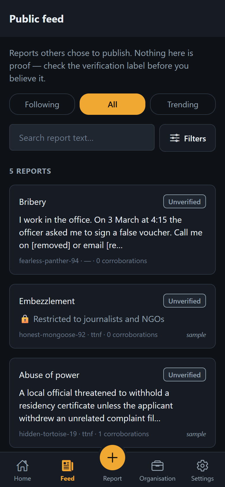
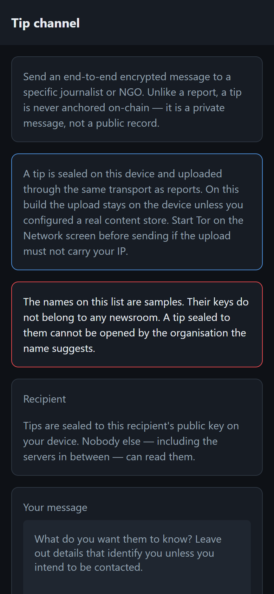
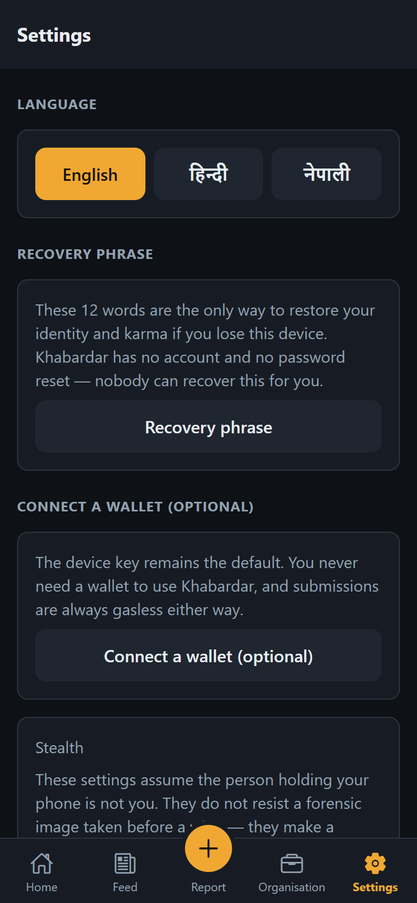

# Architecture

Deep detail on how Khabardar works. For the short version, see the
[README](../README.md). For revenue model and build status, see
[BUSINESS.md](../BUSINESS.md).

## Contents

- [Anonymity model](#anonymity-model)
- [Leak checker](#leak-checker)
- [Why React Native (Expo) and not Flutter](#why-react-native-expo-and-not-flutter)
- [Mock and live mode](#mock-and-live-mode)
- [Blockchain layer (Linea)](#blockchain-layer-linea)
- [Content layer](#content-layer-how-reports-become-readable)
- [Linking reports without deanonymizing anyone](#linking-reports-without-deanonymizing-anyone)
- [Identity: three options, one default](#identity-three-options-one-default)
- [Gasless flow](#gasless-flow-nobody-holds-eth)
- [Sponsored gas pools and attribution](#sponsored-gas-pools-and-attribution)
- [Organizations: the accountable side](#organizations-the-accountable-side)
- [Verification and moderation](#verification-and-moderation)
- [Tip channel](#tip-channel)
- [i18n](#i18n)
- [Egress: one seam for everything](#egress-one-seam-for-everything)
- [Personhood without identity](#personhood-without-identity)

## Anonymity model

Prior art: [GlobaLeaks](https://www.globaleaks.org) and
[SecureDrop](https://securedrop.org), the reference implementations for anonymous
whistleblowing. The design borrows two principles from them:

- **The platform must not be able to deanonymize its users** (SecureDrop: no accounts,
  source codenames, Tor-only). Khabardar's analogue: no signup, a **device-bound
  secp256k1 keypair** generated locally in the secure enclave/Keystore is the entire
  identity. The UI shows a derived codename (e.g. `silent-heron-42`), never the address.
- **Metadata is as dangerous as content** (GlobaLeaks strips file metadata server-side;
  SecureDrop sanitizes documents). Khabardar strips **client-side, before anything is
  stored**: photos are re-encoded through expo-image-manipulator (EXIF/GPS/device tags
  do not survive re-encode), the picker is called with `exif: false`, and Android
  location permissions are **blocked in the manifest** so precise geolocation cannot
  even be requested.

Concrete guarantees in this scaffold:

| Threat | Mitigation |
|---|---|
| Identity leakage at signup | No PII collected, device keypair only (`src/identity.ts`) |
| EXIF/GPS in evidence | Re-encode pipeline (`src/evidence.ts`), then the result is parsed and refused if any identifying metadata survived (`src/photoMetadata.ts`) |
| Identifying details in the report text | On-device leak checker and a privacy check step before review (`packages/shared/src/leaks/`, `app/compose/privacy.tsx`); measured in [LEAK_CHECKER.md](./LEAK_CHECKER.md) |
| Precise location in report | Geohash hard-capped at 4 chars ≈ city level (`src/geo.ts`) |
| Device seizure | AES-256-GCM at rest + **panic delete** wipes drafts, evidence, keys, identity (`src/panic.ts`) |
| Content on a public chain | Only `keccak256` fingerprints go on-chain, never content |
| Network observation | Embedded Tor (Arti) in `modules/expo-tor`, reached through the single egress seam in `src/net/` |
| Device inspected while unlocked | Stealth mode: PIN, duress PIN, disguise, screenshot blocking (`src/stealth.ts`) |
| Sybil corroboration | Semaphore personhood gate (`SemaphorePersonhoodGate.sol`, `src/personhood.ts`) |

## Leak checker

Encryption hides a report from the wrong readers. It does nothing about a report that names its own author to the right ones: "as the only accountant in the district office" is enough for anyone who works there. The leak checker reads the draft on the device and points those details out before submission.

- In text, rule-based detectors in `packages/shared/src/leaks/` find emails, phone numbers, ID numbers, vehicle plates, personal links and handles, street addresses and personal names, plus first-person details that narrow the field (a unique role, "my desk", exact times and dates). `detectLeaks()` returns each finding with its span, a severity and a reason.
- For photos, after the re-encode, `assertPhotoMetadataRemoved` parses the JPEG or PNG and refuses to store it if GPS, an identifying Exif field, XMP, IPTC or a comment survived, or if the file cannot be read. Face and visible-text detection need native modules and are not in any build yet; `src/imageChecks.ts` reports them as unavailable, and the privacy check says so.
- The privacy check step (`app/compose/privacy.tsx`) sits between compose and review. It highlights each finding in the report and offers Fix, Redact or Keep anyway. It advises and never blocks.

It is pure TypeScript and a few word lists, so it makes no network requests and runs offline; the draft is the most sensitive thing the app holds, and sending it anywhere to be checked would create the copy the rest of the design avoids. Coverage, limits and the measured precision and recall are in [LEAK_CHECKER.md](./LEAK_CHECKER.md); `npm run eval:leaks` reproduces the numbers.

## Why React Native (Expo) and not Flutter

Both are fine cross-platform frameworks; the deciding factor is the **blockchain layer**:

1. **The entire Ethereum/AA toolchain is TypeScript-first.** viem, permissionless.js,
   Pimlico/thirdweb/Biconomy SDKs are all TS. Dart bindings (web3dart) lag badly on
   ERC-4337/EIP-7702 support; we would end up hand-rolling UserOperation plumbing.
2. **One language across the monorepo.** The app imports the contract ABI and types
   directly from `@khabardar/shared`; contract changes surface as compile errors in the
   app.
3. **Expo's security-relevant modules** (SecureStore → Keychain/Keystore, expo-crypto,
   ImageManipulator for EXIF-free re-encode) cover our anonymity primitives out of the
   box, plus EAS OTA updates let us ship security fixes without store review delays.

## Mock and live mode

One switch decides whether the app talks to real infrastructure: `EXPO_PUBLIC_KHABARDAR_MODE` in the app, or `KHABARDAR_MODE`, which wins when both are set so a one-off script run can override `.env`. `apps/mobile/src/runtimeConfig.ts` is the only place that reads it, and the relayer, content store, feed source and karma read all come from its result.

- Mock, the default, uses the mock relayer, the mock content store and the mock feed. Nothing leaves the device and no credentials are needed.
- Live turns each piece on once its variables are complete: the relayer with a key and a registry address, the IPFS store with its three `EXPO_PUBLIC_IPFS_*` values, the feed from an indexer or directly from the registry. A piece with missing or malformed variables stays on its mock, and the reason is logged once, never the values. Live mode refuses to run against Linea mainnet (59144).

What live mode exposes, and to whom, beyond what the chain itself publishes:

| Service | Sees |
|---|---|
| Relayer or bundler | The signed submission and the connecting IP address |
| IPFS pinning service | Encrypted bundles and evidence blobs (never plaintext) and the connecting IP address |
| RPC endpoint and indexer | Which reports and blocks are read, and the connecting IP address |

The IP address is the reason the egress seam exists: with Tor running, each of these sees an exit relay instead (see [Egress](#egress-one-seam-for-everything)). Secrets live only in a local `.env`, which is gitignored; `.env.example` documents every variable with placeholders.

When a live piece fails, `src/submitErrors.ts` tells the reporter which: no connection, storage down, relayer down, wrong network, or the fail-closed anonymity switch refusing to send. The report is queued on the device either way and retried when the reporter chooses.

## Blockchain layer (Linea)

- **Chains:** Linea Sepolia testnet (`59141`) now; Linea mainnet (`59144`) later.
- **Why Linea:** post-Pectra Linea supports **EIP-7702** natively and serves ERC-4337
  bundler methods on `rpc.linea.build`; the AA provider ecosystem (Pimlico, thirdweb,
  Etherspot, Biconomy, Arka) is first-class. Status Network, previously the "gasless
  L2" on the Linea stack, **merged into Linea (April 2026)**, so we build against
  Linea directly and borrow Status's ideas rather than their SDK:
  - **Karma:** non-transferable reputation (`ReportRegistry.karma`), credibility that
    cannot be bought or transferred, only earned through verified reports.
  - **RLN-style rate limiting:** planned. Sybil-resistant per-epoch submission limits
    to keep a gasless endpoint spam-free ([#10](https://github.com/sailenceresw/khabardar/issues/10)).

**`ReportRegistry.sol`** stores per report: `reportHash` (fingerprint of the encrypted
bundle), `cid` (pointer to that bundle in the content layer), category, visibility,
verification tier, coarse geohash, blinded `entityTag`, timestamp, and the pseudonymous
reporter address. Tiers are set by an equal-weight secret-ballot jury, not by any
single address: jurors commit a hashed verdict, reveal it in a second round, and an
abandoned ballot is the one thing a juror is penalised for.

## Content layer: how reports become readable

The chain holds a hash and a pointer; the bytes live elsewhere. Without this, a report
is a diary entry nobody else can read.

| Layer | Holds |
|---|---|
| Device | plaintext, only while composing |
| Content store (IPFS/Arweave) | the **encrypted** bundle + evidence blobs |
| Chain | `reportHash` + `cid` + coarse metadata |

Each report gets a **fresh content key**. What happens to that key is the whole
visibility model:

- **Public:** the key is published in the bundle's keyring, so anyone can read it.
- **Journalists only:** the key is wrapped per recipient with **ECIES**
  (ephemeral secp256k1 ECDH → HKDF-SHA256 → AES-256-GCM). Only a listed private key
  opens it; everyone else sees the report as locked.

Because `reportHash` covers the *encrypted* bundle, any reader can recompute it and
compare against the chain. The feed does this on every fetch and shows
`⚠️ Content does NOT match the on-chain fingerprint` when it fails, so a hostile
gateway that swaps or edits a bundle is detected rather than believed. Malformed
responses degrade to "unavailable" instead of throwing, so a bad gateway cannot crash
the reader either.

`EXPO_PUBLIC_KHABARDAR_MODE` selects `mock` (default, local, no credentials) or `live`.
In live mode the IPFS store is used once its three `EXPO_PUBLIC_IPFS_*` variables are
set; until then the app stays on the mock store and says why. The switch lives in
`apps/mobile/src/runtimeConfig.ts`.



The public feed is where that verification surfaces. It filters by category,
verification tier, time window, and area code, searches free text over readable bodies,
and marks restricted bundles as locked rather than hiding them. Sample rows are labelled
`sample` so a fictional report can never be mistaken for a real one. Those rows must be
removed before deployment ([#21](https://github.com/sailenceresw/khabardar/issues/21)).

<br clear="right">


## Linking reports without deanonymizing anyone

Several people reporting the same office is the strongest signal the system has. Doing
that naively means publishing the accused entity's name on-chain.

Instead, the entity name **stays on the device** and only
`keccak256("khabardar/entity-tag/v1" | normalized(name))` is published. Identical
entities produce identical tags, so reports cluster (`reportsForEntity`), while the tag
itself carries nothing about who filed it. Normalization is aggressive, so
`"Block Development Office, Sitapur"` and `"block development office sitapur"` collide.

**Honest limit:** this is not hiding the entity from a determined observer. The set of
public offices is enumerable, so tags are reversible by dictionary attack. That is an
accepted trade-off: *the accused is not the secret, the reporter is.* What it does buy
is keeping entity names out of restricted reports entirely and out of casual chain
scraping.

Separately, `corroborate(reportId)` lets a witness back a report; the contract blocks
self-corroboration and double-voting, and auto-promotes to `CommunityCorroborated` at
3 independent corroborations. **This is only as sybil-resistant as the caller set**, so
production must gate it behind proof-of-personhood
([#10](https://github.com/sailenceresw/khabardar/issues/10)).

## Identity: three options, one default

| Mode | How | Anonymity |
|---|---|---|
| **Device key** (default) | secp256k1 key generated on-device from a BIP-39 phrase | Strongest, tied to nothing else |
| **Recovery phrase** | Same key, restorable on a new device from 12 words | Same as above |
| **WalletConnect** (opt-in) | Sign with an external wallet | **Weaker**, see below |

There is deliberately **no email/phone login**. An auth provider is one subpoena away
from deanonymizing every reporter; a BIP-39 phrase gives the same "don't lose
everything with your phone" benefit with nothing held by anyone but the user.

**WalletConnect** is available for people who already manage keys, but it is never the
default and never required. The screen shows an unmissable warning *above* the connect
control, because a reused wallet carries a public history. Exchange withdrawals tie it
to KYC, and reusing it later can retroactively expose past reports. Requires
`EXPO_PUBLIC_WALLETCONNECT_PROJECT_ID`; without it the screen says so and the device key
keeps working.

## Gasless flow (nobody holds ETH)

```
device keypair ──owns──▶ counterfactual smart account (SimpleAccount)
      │                             │
      │ signs userOpHash            │ sender of UserOperation
      ▼                             ▼
UserOperation{ callData: submitReport(hash, category, geohash) }
      │
      ├─▶ pm_sponsorUserOperation  (Pimlico verifying paymaster: sponsor pays)
      └─▶ eth_sendUserOperation    (Pimlico bundler → EntryPoint v0.7 on Linea)
```

The relayer is an interface (`src/relayer/`) with two implementations:

- **`MockRelayer` (default):** runs the identical encode → sign pipeline, then simulates
  the bundler locally. No network, no credentials. This is what the scaffold demo uses.
- **`PimlicoRelayer`:** real integration points against Pimlico's bundler/paymaster
  JSON-RPC on Linea Sepolia, env-gated. Written against raw `pm_sponsorUserOperation` /
  `eth_sendUserOperation` so the protocol surface is explicit; swap in permissionless.js
  to productionize.

**What a real gasless setup needs** (~15 min):

1. Create an API key at [dashboard.pimlico.io](https://dashboard.pimlico.io).
2. Add a **sponsorship policy** scoped to your deployed `ReportRegistry` address
   (so the paymaster only ever sponsors report submissions), and fund it.
3. Deploy the contract: `npm run contracts:deploy:sepolia` (needs
   `DEPLOYER_PRIVATE_KEY` + Sepolia ETH from the
   [Linea faucet](https://docs.linea.build/get-started/how-to/get-testnet-eth)).
4. Set in `.env`: `EXPO_PUBLIC_KHABARDAR_MODE=live`,
   `EXPO_PUBLIC_PIMLICO_API_KEY`, `EXPO_PUBLIC_REPORT_REGISTRY_ADDRESS`.
5. Finish the two marked TODOs in `pimlicoRelayer.ts`: counterfactual account
   derivation ([#3](https://github.com/sailenceresw/khabardar/issues/3)) and receipt
   polling ([#4](https://github.com/sailenceresw/khabardar/issues/4)). Or replace the
   class body with permissionless.js's `createSmartAccountClient`, which handles both.

Alternative providers (same interface, different config): thirdweb, Etherspot Prime,
Biconomy, or self-hosted [Arka](https://github.com/etherspot/arka) if operator
independence from a commercial paymaster is required, likely the right endgame for an
anti-corruption tool.

### Signed forwarding (self-hosted relayer)

The second gasless path needs no bundler or paymaster. `ReportRegistry` trusts one
ERC-2771 forwarder, `KhabardarForwarder`, which is OpenZeppelin's `ERC2771Forwarder`
unchanged. The phone signs an EIP-712 `ForwardRequest` for a `submitReport` call with
its device key, and a relayer the operator runs submits it and pays the gas. The
forwarder checks the signature, nonce and deadline, then calls the registry with the
signer's address appended, and the registry reads the reporter from `_msgSender()`.

```
device key ──signs──▶ ForwardRequest{ from, to: registry, data: submitReport(...) }
      │
      ▼
relayer (pays gas) ──execute()──▶ KhabardarForwarder ──call + sender──▶ ReportRegistry
                                                                       reporter = device key
```

What this guarantees, tested in `packages/contracts/test/ForwardedSubmission.test.ts`:
the signer is the reporter and the per-epoch cap counts against the signer; a relayer
cannot change a signed request, replay it, use it after its deadline, or sign one in
someone else's name. The forwarder address is an immutable constructor argument of the
registry, so it cannot be swapped later. The deploy script deploys the forwarder first
and prints both addresses.

Only `submitReport` is meant to go this way. Corroboration and jury votes stay direct
calls, and the personhood gates still read `msg.sender`.

The relayer lives in `packages/contracts/relayer/` and runs with `npm run relayer:start`
(`POST /relay`, `GET /health`). Before paying for anything it checks that the request
calls `submitReport` on the registry with no value, a capped gas limit and a deadline
under an hour away, then verifies the signature and simulates the call, so a forged or
failing request costs it nothing. A global per-minute limit and a daily spend cap stop
one caller from draining the wallet. It keeps no per-IP state and logs no request
bodies, addresses or IPs. It refuses to start on Linea mainnet.

In the app, `ForwarderRelayer` (`src/relayer/forwarderRelayer.ts`) builds the request: it
reads the signer's nonce from the forwarder through the anonymising transport, signs
the EIP-712 request with the device key (or a connected wallet, over
`eth_signTypedData_v4`), and posts it through `netFetch`. It is used in live mode when
`EXPO_PUBLIC_RELAYER_URL`, `EXPO_PUBLIC_FORWARDER_ADDRESS` and the registry address are
all set, and is preferred over Pimlico when both are configured.

### Privacy note on sponsored gas

A paymaster sees the UserOperations it sponsors (sender address, calldata, IP of the
submitting client). Since calldata is only ever a hash + category + coarse geohash,
content stays private, but **network-level anonymity (Tor) is required before mainnet**
to prevent IP↔pseudonym linkage by relayer infrastructure.

## Sponsored gas pools and attribution

Organizations can fund submission gas for a region or category
(`packages/shared/src/sponsor.ts`, `apps/mobile/src/sponsorPools.ts`). Reporters never
see a payment step; the pool only decides who reimburses the paymaster.

**Attribution is aggregate only, by design.** A per-report sponsor tag would be a side
channel: a narrowly-scoped sponsor would shrink a report's anonymity set below what the
reporter consented to by publishing a coarse geohash. So `sponsorPoolId` travels as
paymaster accounting context and is deliberately *excluded from calldata*, sponsors
receive counts rather than per-report ledgers, and any pool below `MIN_SCOPE_REPORTS`
(50) goes unnamed in the UI even though it still pays.

## Organizations: the accountable side

`Organization` (`packages/shared/src/org.ts`, `apps/mobile/src/org.ts`) is a **named**
account for newsrooms, NGOs, oversight bodies, researchers, and funders. It is stored
under separate keys, with a separate lifecycle, from reporter identity, and the two are
never returned together. An org account is billable and contactable, a reporter account
is a device key and nothing else. Joining them would break the product's central
guarantee.

Accreditation is not self-serve: a new org gets Community entitlements regardless of
selected plan until a human verifies it, because analytics over a whistleblower corpus
should never be one signup form away. Plans and entitlements gate corpus export
(`apps/mobile/src/export.ts`), which excludes restricted reports and never exports
reporter addresses.

The organisation side of the app has three pieces built on that separation:

- Reports (`app/org-feed.tsx`) filters the corpus by category, district, verification tier and corroboration count, from whichever source the mode switch picked, and says whether that is mock data or Linea Sepolia.
- Recipient keys (`src/orgRecipientKey.ts`): a restricted report's content key is wrapped to each recipient pinned in the app. An organisation that holds the private half of one of those keys can store it on its own device, and restricted reports sealed to it open there, marked as decrypted on this device. A key is accepted only if it matches a pinned recipient, it is re-checked on every load, it never leaves the device, and it is removed on sign-out, which panic delete calls. Pinning is unchanged: this cannot open anything the reporter did not seal to that organisation.
- Case files (`src/caseFile.ts`) export selected reports as CSV and as an HTML document that prints to PDF. Each report carries its on-chain fingerprint, content address, transaction hash and an explorer link, with the steps to check it has not changed. Report text is escaped, CSV formula cells are neutralised, reporter addresses are left out, and a file made in mock mode says it is not evidence.

## Verification and moderation

Reports move through explicit tiers, and **nothing is presented as credible until it
has moved past `Unverified`**:

`Unverified → UnderReview → CommunityCorroborated → Verified` (or `Disputed`)

The review queue (`/moderation`) lists everything not yet adjudicated, oldest first,
with each report's integrity-check result. A moderator can change a report's **tier**
but can **never edit or delete the report**. The content is anchored on-chain, so
moderation adds judgement on top of an immutable record rather than rewriting it. Every
decision is logged with a reason.

Two things about this are deliberately unfinished and should not be glossed over:

- There is no moderator address left to capture, but the jury is only as independent as
  its seats. Seat at least three unrelated jurors before trusting a verdict: quorum is
  three, and a one-juror jury is exactly the centralization the design removes.
- The decision log is **on-device only**. Production must publish decisions (or their
  hashes) so moderators are auditable by the same public being asked to trust them. A
  moderation system nobody can audit is just censorship with extra steps.
  ([#17](https://github.com/sailenceresw/khabardar/issues/17))

On detecting AI-generated reports: **do not ship a naive AI-text detector.** They have
high false-positive rates on second-language English writers, which describes a large
share of the intended users, so it would systematically silence exactly the people this
exists for. The defensible stack is provenance (C2PA capture signatures), personhood
(RLN / anonymous credentials), and corroboration. AI belongs in triage, never as judge.

## Tip channel



`/tips` sends an end-to-end encrypted message to a named journalist or NGO. Unlike a
report, a tip is **never anchored on-chain**. It is a private message, not a public
record. Sealing uses the same ECIES construction as restricted bundles, so only the
recipient's private key opens it, and only a short preview + digest stay on the device.

Three gaps to close before anyone relies on it, all documented in `src/tips.ts`:

- **Transport.** Tips are sealed but not delivered over an anonymising transport yet.
  Network metadata is what deanonymizes people, not ciphertext.
  ([#9](https://github.com/sailenceresw/khabardar/issues/9))
- **Padding.** Message length currently leaks; tips should be padded to fixed buckets.
  ([#11](https://github.com/sailenceresw/khabardar/issues/11))
- **Forward secrecy.** A recipient key compromise retroactively opens past tips.
  ([#12](https://github.com/sailenceresw/khabardar/issues/12))

Recipient keys in `src/content/recipients.ts` are **demo placeholders**. Production must
publish them somewhere independently verifiable (DNS TXT, a well-known URI on the
organisation's own domain, or an on-chain registry) and pin them in-app, so a compromised
backend cannot silently swap in its own key and read every restricted report.
([#13](https://github.com/sailenceresw/khabardar/issues/13))

## i18n



English + Hindi (`apps/mobile/src/i18n/`). Locale auto-detects from the device and can
be switched in Settings. All UI strings go through `t()`, so adding a language means
dropping in a new JSON file.

Language coverage is not cosmetic here. The people best placed to report corruption are
often not comfortable in English, and a tool that only speaks English selects for the
wrong reporters. Expanding beyond Hindi and English, and adding voice-first input, is
[#26](https://github.com/sailenceresw/khabardar/issues/26), with the hard constraint
that speech recognition must run **on-device**, since a cloud speech API would receive
the reporter's voice and IP address together.

<br clear="right">

## Egress: one seam for everything

Every outbound request in the app goes through `apps/mobile/src/net/transport.ts`.
That is the point of the module: there is exactly one place where a packet can leave,
so "is this protected?" has one answer rather than one per call site.

Three transports, strongest first:

1. **Embedded Tor.** Arti compiled into the app (`modules/expo-tor`, Rust with JNI and
   Swift bindings), exposing a loopback SOCKS5 proxy. Hostnames are resolved by the
   exit rather than locally, so there is no DNS leak, and each report submission gets a
   fresh circuit so two submissions cannot be linked by a shared exit relay. Needs a
   native build: Expo Go and the web preview cannot load it.
2. **An HTTP proxy fronting Tor**, such as an Orbot port. Weaker, because the proxy
   operator sees every destination, and the app labels it "claimed but not verified"
   because it cannot confirm the proxy reaches Tor at all.
3. **Direct.** The IP reaches the relayer, gateway and RPC. What you get with neither
   of the above.

`setRequireAnonymity(true)` makes the seam **fail closed**: an unprotected request
raises `AnonymityRequiredError` instead of going out. A per-host egress log is shown to
the user, because a privacy claim nobody can inspect is just a promise.

viem does not get an exception. `anonymisingRpcTransport()` wraps chain reads so the
relayer and the feed index go through `rpcCall` like everything else, rather than
viem's own fetch.

## Personhood without identity

`SemaphorePersonhoodGate.sol` gates corroboration on Semaphore group membership. A
member proves they belong without revealing which member they are, and a nullifier
stops the same member acting twice on one report. The contract tests generate real
Groth16 proofs and verify them on-chain, negative cases included.

The deliberate constraint: the gate must never become an identity system. Anything
requiring a phone number or a government ID would reintroduce exactly the
deanonymization risk the product exists to remove, which is why group membership and a
nullifier are the whole mechanism.

`modules/expo-zkprove` is the on-device prover, so a phone can produce the proof
itself rather than asking a server to do it, which would hand that server the link it
is supposed to not have. It builds for Android and is verified against the reference
implementation, and it has not yet run on real hardware.
